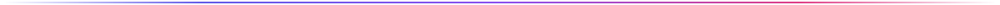

<!-- Live cards come from the "output" branch, rebuilt every 6 hours by .github/workflows/profile.yml.
     Static art in assets/ is generated by .github/scripts/build-assets.mjs. -->

 

<table>
<tr>
<td width="46%" valign="top">

### 🦇 Who's behind the mask

CSE undergraduate at **American International University-Bangladesh (AIUB)**, Dhaka. By day I build full-stack apps; by night I train models.

- 🛡️ &nbsp;APIs with **C# · ASP.NET Core**
- ⚡ &nbsp;Front-ends with **Angular** and **React**
- 🩻 &nbsp;Thesis: **BanglaCXR**, chest X-ray reports in Bangla
- 📱 &nbsp;Cross-platform apps with **Flutter**
- 🤖 &nbsp;Into **robotics & drones**
- 📚 &nbsp;Reader. *Learning through mistakes.*

</td>
<td width="54%" align="center" valign="middle">

</td>
</tr>
</table>

## 🛠️ The utility belt

 

 

## 📁 Case files

<table>
<tr>
<td width="50%" valign="top">

#### 🩻 [BanglaCXR](https://github.com/ahasan-ullah/Thesis)
Two-stage vision-language pipeline that turns a chest X-ray into a structured radiology report, then renders it in **Bangla**. RAD-DINO encoder → Phi-3.5 Mini (4-bit QLoRA) → NLLB-200.

</td>
<td width="50%" valign="top">

#### 🏢 HRMS — [API](https://github.com/ahasan-ullah/HRMS-API) · [Client](https://github.com/ahasan-ullah/HRMS-Client)
Human resource management system: an ASP.NET Core Web API backend with an Angular 17 front-end.

</td>
</tr>
<tr>
<td width="50%" valign="top">

#### 🛒 [Online Marketplace API](https://github.com/ahasan-ullah/Online-Marketplace-API)
REST API for an online marketplace, built with C# and ASP.NET Core.

</td>
<td width="50%" valign="top">

#### 🗂️ Management System — [Client](https://github.com/ahasan-ullah/Management-System-Client) · [Server](https://github.com/ahasan-ullah/Management-System-Server)
Full-stack app with a React + Vite + Tailwind client and an Express + MongoDB server secured with JWT.

</td>
</tr>
<tr>
<td width="50%" valign="top">

#### 🎟️ [EventEase](https://github.com/ahasan-ullah/Event-Ease)
Event management web app: organizers host events, users browse, register and manage bookings.

</td>
<td width="50%" valign="top">

#### 🙂 [FaceApi.js Integration](https://github.com/ahasan-ullah/FaceApi.js-Integration)
In-browser face detection with face-api.js.

</td>
</tr>
</table>

## 🖥️ Batcomputer analytics

### 🦇 Night patrol

